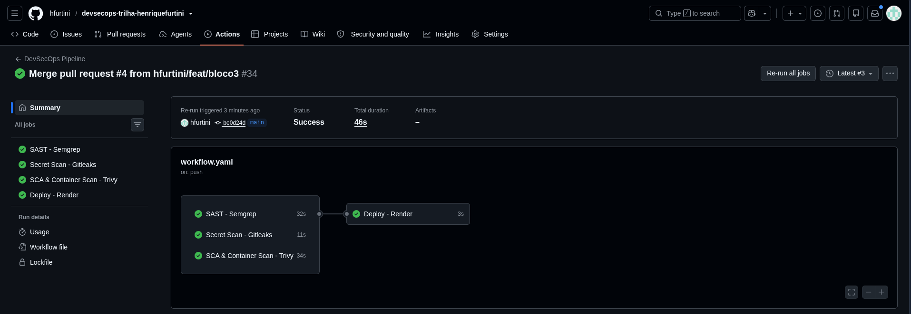

# Bloco 4 – Pipeline DevSecOps

**Aluno:** Henrique Araújo Furtini
**Aplicação publicada:** [Render](https://devsecops-trilha-henriquefurtini.onrender.com)
**Repositório:** [GitHub](https://github.com/hfurtini/devsecops-trilha-henriquefurtini.git)


## 1. Visão geral da pipeline

A pipeline está definida em um workflow do **GitHub Actions** ("DevSecOps Pipeline") e é executada a cada **push** e **pull request** na branch `main`. A aplicação é um serviço **Node.js** que fica na pasta `app/` e é empacotada em uma imagem Docker.

O workflow tem quatro jobs:

| Job | Ferramenta | Tipo de análise |
|-----|-----------|-----------------|
| `sast-semgrep` | Semgrep | SAST (análise estática do código) |
| `secret-scan-gitleaks` | Gitleaks | Detecção de segredos no código e no histórico |
| `sca-container-trivy` | Trivy | SCA (dependências) e scan da imagem Docker |
| `deploy-render` | Deploy Hook do Render | Publicação automática |

Os três jobs de segurança rodam **em paralelo**, o que deixa a pipeline mais rápida. O job de deploy declara `needs` para os três, então **só executa se todos os gates passarem**. Além disso, ele só roda em **push na `main`** (`if: github.ref == 'refs/heads/main' && github.event_name == 'push'`), de modo que pull requests passam pelas verificações mas nunca publicam nada.

A ideia é encontrar problemas o mais cedo possível e **bloquear o deploy** quando algo grave aparece. Cada gate falha o job ao encontrar um problema dentro do critério configurado.




## 2. Gates de segurança

### 2.1 Semgrep – SAST

- **O que verifica:** o código-fonte da pasta `app/`, em busca de padrões inseguros (injeções, uso perigoso de funções, configurações fracas etc.), sem precisar executar a aplicação.
- **Como foi configurado:** o job roda a imagem oficial `semgrep/semgrep` com `semgrep scan --config=auto --error app/`.
  - `--config=auto` baixa do registro do Semgrep as regras adequadas às linguagens detectadas no projeto (JavaScript/Node.js), sem precisar manter regras manualmente.
  - `--error` faz o comando retornar erro quando há achados, o que reprova o job e impede o deploy.
  - O escopo é `app/`, para analisar só o código da aplicação.
- É a configuração mais simples que cobre as categorias mais comuns de falhas de código e garante que nenhum achado passe silenciosamente.

### 2.2 Gitleaks – detecção de segredos

- **O que verifica:** credenciais, tokens e chaves de API commitados no repositório, **inclusive no histórico do Git**.
- **Como foi configurado:**
  - `actions/checkout` com `fetch-depth: 0`, para baixar todo o histórico. Sem isso, só o último commit seria analisado.
  - Execução via Docker: `gitleaks detect --source="/repo" --verbose --redact`.
  - `--redact` mascara o valor do segredo nos logs, para que a própria pipeline não exponha o que encontrou.
  - Ao detectar um vazamento, o Gitleaks retorna erro e o job falha.
- Um segredo removido em um commit posterior continua acessível nos commits antigos, então a varredura precisa cobrir todo o histórico. E, como o vazamento exige troca da credencial, bloqueia-se o deploy.

### 2.3 Trivy – dependências e imagem Docker

O job tem duas etapas, com critérios diferentes:

**a) SCA das dependências (`scan-type: fs`, alvo `./app`)**
- **O que verifica:** CVEs conhecidas nas dependências do projeto (`package.json` / `package-lock.json`).
- **Configuração:** severidade `CRITICAL,HIGH` e `exit-code: 1`, ou seja, qualquer vulnerabilidade alta ou crítica reprova o job.
- As dependências são responsabilidade do projeto e geralmente podem ser corrigidas com uma atualização de versão, então o critério é mais rigoroso.

**b) Scan da imagem Docker (`app-saci:scan`)**
- **O que verifica:** CVEs no sistema base da imagem (Alpine) e nos pacotes instalados nela.
- **Configuração:** a imagem é construída no próprio job (`docker build -t app-saci:scan ./app`), e o scan usa severidade `CRITICAL`, `ignore-unfixed: true` e `exit-code: 1`.
- Vulnerabilidades da camada do sistema operacional podem não ter correção disponível. `ignore-unfixed` evita bloquear a pipeline por algo que não dá para consertar, e o corte em `CRITICAL` mantém o foco no que é realmente grave.

**Correcões no Dockerfile** (`node:22-alpine`):
- Imagem base **Alpine**, pequena, o que reduz a superfície de ataque e a quantidade de pacotes a vulnerabilizar.
- `npm ci --omit=dev`: instalação reprodutível a partir do lockfile e **sem dependências de desenvolvimento** na imagem final (com fallback para `npm install --omit=dev` caso não exista lockfile).
- `USER node`: o processo roda como **usuário não root**, limitando o estrago em caso de comprometimento.

| # | Ferramenta | Vulnerabilidade | Onde | Como foi tratada |
|---|-----------|-----------------|------|------------------|
| 1 | Semgrep | Possível Path Traversal (`path-join-resolve-traversal`) | files.js:16 | **Falso positivo**, suprimido com `nosemgrep` e justificativa no código (detalhes abaixo) |

#### Falso positivo: Path Traversal (Semgrep)

- **Regra:** `javascript.lang.security.audit.path-traversal.path-join-resolve-traversal.path-join-resolve-traversal`
- **Local:** `files.js:16`
- **Classificação:** falso positivo, suprimido apenas nessa linha e apenas para essa regra.

**O que a regra detecta.** Ela alerta sempre que um valor possivelmente controlado pelo usuário chega a `path.join` ou `path.resolve`. Essas funções só normalizam o caminho e não impedem a saída do diretório base (por exemplo, `../../etc/passwd`). Por ser uma regra de *audit* baseada em padrão, ela não acompanha as validações feitas antes da chamada, e por isso aponta o problema mesmo com a entrada já protegida.

**Por que não é explorável neste caso:** O valor `requestedName` passa por duas barreiras antes de chegar ao `path.join`:

1. **Allowlist:** ele só é usado se existir na lista retornada por `readdir()`. Um valor como `../../etc/passwd` não está nessa lista e a requisição é rejeitada.
2. **`path.basename()`:** remove qualquer componente de diretório, então, mesmo que algo inesperado passasse pela allowlist, só restaria o nome do arquivo, sem `../` nem `/`.

**Como foi tratado.** Foi adicionado um comentário `nosemgrep` com o ID completo da regra, logo acima da linha sinalizada, junto com a justificativa:

```js
// Falso positivo: requestedName só chega aqui se existir em readdir()
    // (allowlist) e ainda passa por path.basename().
    // nosemgrep: javascript.lang.security.audit.path-traversal.path-join-resolve-traversal.path-join-resolve-traversal
    const safePath = path.join(UPLOADS_DIR, path.basename(requestedName));
    callback(null, safePath);
```

A supressão não desliga a regra no projeto: o resto do código continua sendo verificado, e o job do Semgrep segue com `--error`, reprovando a pipeline em qualquer outro achado.


## 3. Vulnerabilidades encontradas e correções

| # | Ferramenta | Vulnerabilidade | Onde | Como foi corrigida |
|---|-----------|-----------------|------|--------------------|
| 1 | Semgrep | Command Injection (CWE-78) | `/app/src/routes/network.js` | Troca de `child_process.exec()` por `execFile()` com validação estrita de IP/hostname ||
| 2 | Revisão manual (não detectado pelo Gitleaks) | Segredos hardcoded (`JWT_SECRET`, `AWS_ACCESS_KEY_ID`, `AWS_SECRET_ACCESS_KEY`) | `/app/src/config.js` | Movidos para variáveis de ambiente lidas via `process.env` (detalhes abaixo) |
| 3 | Trivy | CVEs críticas na imagem base `node:14` (sem suporte) e em dependências (`lodash 4.17.15`, `jsonwebtoken 8.5.1`) | `Dockerfile` e `package.json` | Migração para `node:22-alpine` e atualização das dependências (`package.json` + `npm audit fix`) |

#### Segredos hardcoded no módulo de configuração

- **Local:** `config.js`
- **Risco:** credenciais escritas direto no código ficam no repositório e em todo o histórico do Git, acessíveis a qualquer pessoa com acesso de leitura. Um segredo de assinatura de JWT vazado permite forjar tokens válidos, e chaves da AWS vazadas permitem uso indevido da conta.
- **Por que o Gitleaks não detectou:** eram valores de exemplo (não credenciais reais),as chaves de exemplo da AWS são ignoradas pela allowlist padrão da ferramenta, e o JWT_SECRET estava em texto puro. O Gitleaks identifica segredos por padrões de formato e entropia, e valores fictícios.Isso mostra que o gate é uma rede de segurança, e não substitui a revisão de código.

**Correção:** O módulo de configuração passou a ler os valores do ambiente, sem nenhum segredo no código:

```js
module.exports = {
  JWT_SECRET: process.env.JWT_SECRET || "",
  AWS_ACCESS_KEY_ID: process.env.AWS_ACCESS_KEY_ID || "",
  AWS_SECRET_ACCESS_KEY: process.env.AWS_SECRET_ACCESS_KEY || "",
};
```

#### Command Injection em `network.js` (Semgrep)

- **Local:** `/app/src/routes/network.js``
- **Risco:** a entrada do usuário era concatenada em um comando passado a `child_process.exec()`. Como o `exec()` executa o comando em um shell, caracteres como `;`, `&&` e `|` permitiam encadear comandos arbitrários no servidor (por exemplo, uma entrada como `8.8.8.8;`.
- **Correção:**
  1. `exec()` foi substituído por `execFile()`, que não abre um shell e recebe os argumentos como lista, então a entrada é tratada como dado, e não como parte do comando.
  2. Foi adicionada validação estrita do valor recebido: só aceita IP ou hostname em formato válido, rejeitando qualquer outra coisa antes da execução.

```js
const { execFile } = require("child_process");

const net = require("net");

function isValidHost(host) {
  if (typeof host !== "string" || host.length === 0 || host.length > 253) {
    return false;
  }
  return net.isIP(host) !== 0 || HOSTNAME_REGEX.test(host);
}

```

#### Imagem base e dependências desatualizadas (Trivy)

- **Local:** `Dockerfile` (imagem base) e `package.json` (dependências)
- **Achados:** a varredura do sistema de arquivos e da imagem Docker apontou múltiplas CVEs críticas.
  - **Imagem base `node:14`:** versão sem suporte oficial, que não recebe mais correções de segurança.
  - `lodash 4.17.15`
  - `jsonwebtoken 8.5.1`
- **Correção:**
  1. O `Dockerfile` passou para **`node:22-alpine`**, uma versão suportada e mínima, o que reduz a superfície de ataque e o tamanho da imagem.
  2. As dependências foram atualizadas via `package.json` e `npm audit fix`.
- O scan de dependências reprova a pipeline para severidade HIGH e CRITICAL, e o scan da imagem para CRITICAL, impedindo que essas versões cheguem ao deploy.

## 4. Deploy automático no Render

O deploy é feito por **Deploy Hook**, acionado pela própria pipeline:

1. No último job (`deploy-render`), o comando `curl -f -X POST "${{ secrets.RENDER_DEPLOY_HOOK }}"` chama a URL do hook do Render. A flag `-f` faz o `curl` falhar se o Render responder com erro, e o job fica vermelho em vez de dar falsa impressão de sucesso.
2. A URL do hook é um segredo e fica guardada em **GitHub Secrets** (`RENDER_DEPLOY_HOOK`), nunca no código. Quem tem essa URL consegue disparar deploys.
3. O job usa `needs: [sast-semgrep, secret-scan-gitleaks, sca-container-trivy]`, então **nenhum deploy acontece se algum gate falhar**.
4. A condição `github.ref == 'refs/heads/main' && github.event_name == 'push'` garante que só mudanças integradas à `main` sejam publicadas.

Resultado: todo push aprovado na `main` publica automaticamente uma nova versão da aplicação.

**Configuração do serviço no Render:**
- Build/Start: O Render usa o Dockerfile em `app/`;
- Auto-Deploy do Render por commit: desativado, para o deploy ocorrer somente pelo hook após os gates.


## 5. Links

- **Aplicação publicada:** https://devsecops-trilha-henriquefurtini.onrender.com
- **Repositório final:** https://github.com/hfurtini/devsecops-trilha-henriquefurtini.git
